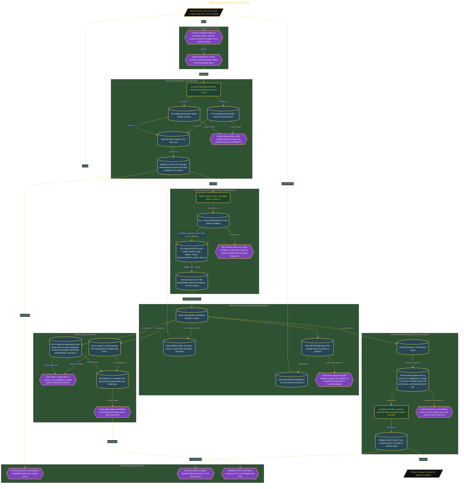

# Build an Architecture Decision Log

> Inside the [Build & Brew: The AI Dojo](../../README.md) cohort · *A live build toward the high-performing solutions engineer.*

## Overview

A decision log written after the fact measures memory, not decisions. This build keeps a local architecture decision log whose credibility rests on order: the workload evidence and the decision inventory are committed before any record exists, so the coverage denominator is fixed in Git history and cannot be quietly trimmed to whatever the records happened to cover. Two supplied workload files and five design documents were copied exactly as given, with no edits, so the reading baseline is the supplied material rather than a retelling of it.

The denominator then grew from evidence rather than opinion. A Python checker, written against the standard library and committed before it was run, scanned `workload/main.tf` and found six settings. Five of them appeared nowhere in the four note rows: `image`, `instance_type`, `engine_version`, `backup_retention_period`, and `multi_az`. Those rows went into the inventory and the decision count moved from four to nine, with the Terraform files never modified, so discovery could not change the thing being measured. Three note-backed records were written against that larger denominator, and the rest stayed visible as an uncovered-decision backlog rather than disappearing.

The record format keeps two kinds of statement apart. A RECORDED driver ties a fact to a source, so the next owner can check the claim instead of trusting a retelling. A NOT RECORDED driver keeps the missing reason as a question, so nobody fills the gap with an invented rationale. Known facts stay traced and unknown reasons stay visible, which is what makes the handover honest rather than tidy.

The checker was then proven to fail. Run 2 rejected a record missing its `## Consequences` heading and exited 1; run 3 rejected a supersession that pointed only one way, naming the broken link between ADR-0004 and ADR-0005, and exited 1. Both failing runs were kept as evidence and the records restored before the clean pass, so the pass means something. The same standard was turned on the handover itself: the first readout draft scored 3 of 28 traced claims, and three material claims had no source in any supplied file, including a ready-to-run line, an artifact claim with no file trace, and the draft's own self-scored 0 of 27. A self-scored line is not evidence, so it went with the others. The shipped readout scores 0 owed, because every claim left on the page is either traced to a file or marked as owed.

## Architecture

The diagram shows the topology and data flow of the system as built. The full architectural narrative, with screenshots and prose, lives in [`documents/coverage-checked-decision-log.md`](./documents/coverage-checked-decision-log.md).

## Implementation

This system is built across **7 phases**:

1. Framing an Evidence-Led Decision Log
2. Establishing a Traceable Local Repository
3. Committing the Evidence Baseline First
4. Discovering Decisions with a Coverage Checker
5. Recording Decisions and Preserving Open Questions
6. Proving the Checks and Inventory History
7. Auditing the Final Product-Manager Readout

For the full walkthrough with screenshots and step-by-step content, see [`documents/coverage-checked-decision-log.md`](./documents/coverage-checked-decision-log.md).

## Validation

Each build phase below is documented in [`documents/coverage-checked-decision-log.md`](./documents/coverage-checked-decision-log.md), with screenshots, configuration, and notes as captured during the build:

- ✅ Framing an Evidence-Led Decision Log
- ✅ Establishing a Traceable Local Repository
- ✅ Committing the Evidence Baseline First
- ✅ Discovering Decisions with a Coverage Checker
- ✅ Recording Decisions and Preserving Open Questions
- ✅ Proving the Checks and Inventory History
- ✅ Auditing the Final Product-Manager Readout
