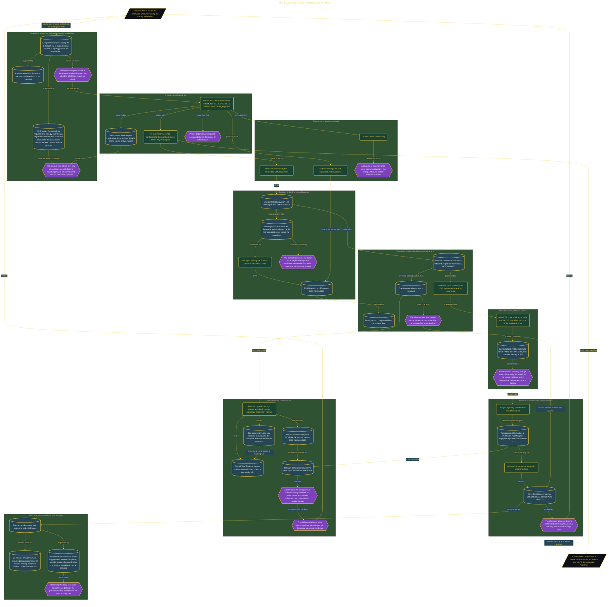

# The Score Was Right, the Data Was Wrong

> Inside the [Build & Brew: The AI Dojo](../../README.md) cohort · *A live build toward the high-performing solutions engineer.*

## Overview

A trained model is usually identified by a filename and a score, and both can be produced by the wrong data. This build makes that identity testable. A classifier is trained on the EPA eGRID2023 workbook, and every accepted model has to name one Git commit, one workbook MD5 fingerprint and one registry version, so a reviewer can tell which source bytes produced which model without taking the builder's word for it.

The evidence contract was written before any model code. A requirements brief carrying AC-1 through AC-6, eight decision records, a topology and a 45-minute plan were committed first, with a source map of 31 links tying each decision to its reference. AC-6 named the exact lines the final readout needed: one `train.py` commit, two different registration hashes, two source `SCHEMA OK` events, the clean-clone passes, the deliberate exit 1 failure and the later recovery. The readout could tick an item only when `check-out.txt` held the matching line, which is what stops a finished score from deciding afterwards what counts as proof.

Three tools were given three separate jobs. Git carries the source history, DVC tracks the workbook bytes by fingerprint, and MLflow retains the runs and the registered versions. Revision 1 printed `SCHEMA OK` for **3,274 plants** at a ROC AUC of **0.9137**, with the 21 MB workbook staying outside the repository and only its pointer, MD5 `932a841d`, committed to Git. Revision 2 was then tracked, retrained and registered as version 2 at MD5 `2449e137`, and the champion alias was moved to it so the checker compares against one chosen model rather than a run identifier a reviewer has to go and find.

The clean clone is where the claim was tested rather than asserted. A fresh clone held the code and the DVC metadata but none of the workbook bytes: the commit check passed, the ROC AUC check passed, and the run still failed on `data_md5`, which shows Git alone does not carry enough to rebuild or verify the model. Running `dvc pull` fetched **1 file**, the recovered workbook hashed to `2449e137`, and a forced retrain returned three `PASS` lines and `ALL CHECKS PASS` at a ROC AUC of **0.914372**. The champion was rebuilt from named artifacts rather than from files left behind in the original working directory.

The sharpest result is the one that was made to fail. A diagnostic run pushed the revision 1 workbook through training and checking without registering it: the old data still printed `SCHEMA OK` and still passed the ROC AUC check at **0.9137**, so on performance and schema alone it looked acceptable. The MD5 comparison rejected the stale bytes and returned **exit code 1**, and the registry still held only versions 1 and 2 with the champion resolving to version 2. A score close to the champion can hide the wrong workbook, which is why the fingerprint stays in the check. The clock is recorded honestly too: the build took about **one and a half hours** against a 45-minute plan, most of the overrun a model-logging error resolved by pinning an older `skops`, and the shared DVC remote and hosted MLflow server that would let a team do this from separate machines are named as owed rather than claimed.

## Architecture

The diagram shows the topology and data flow of the system as built. The full architectural narrative, with screenshots and prose, lives in [`documents/egrid-model-lineage-rebuild.md`](./documents/egrid-model-lineage-rebuild.md).

## Implementation

This system is built across **6 phases**:

1. Setting Up a Reproducible Lineage Lab
2. Designing the Evidence Chain
3. Training and Tracking Revision 1
4. Registering Revision 2 and Testing Lineage Checks
5. Rebuilding the Champion from Verified Artifacts
6. Investigating an Unregistered Diagnostic Run

For the full walkthrough with screenshots and step-by-step content, see [`documents/egrid-model-lineage-rebuild.md`](./documents/egrid-model-lineage-rebuild.md).

## Validation

Each build phase below is documented in [`documents/egrid-model-lineage-rebuild.md`](./documents/egrid-model-lineage-rebuild.md), with screenshots, configuration, and notes as captured during the build:

- ✅ Setting Up a Reproducible Lineage Lab
- ✅ Designing the Evidence Chain
- ✅ Training and Tracking Revision 1
- ✅ Registering Revision 2 and Testing Lineage Checks
- ✅ Rebuilding the Champion from Verified Artifacts
- ✅ Investigating an Unregistered Diagnostic Run
