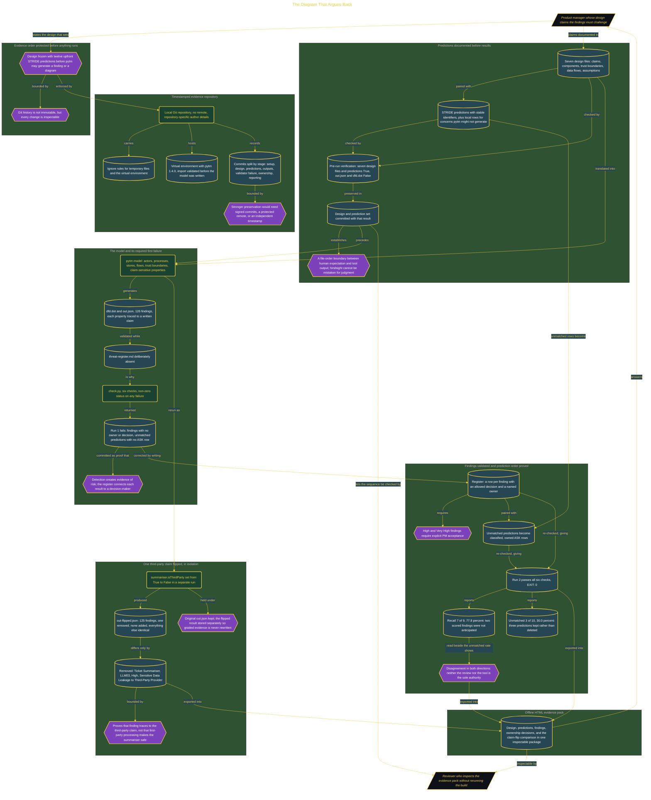

# The Diagram That Argues Back

> Inside the [Build & Brew: The AI Dojo](../../README.md) cohort · *A live build toward the high-performing solutions engineer.*

## Overview

A threat model that a product manager has to take on faith is a diagram, not evidence. This build is an investigation arranged so the findings can argue with the design without rewriting what was expected of it: a local Git repository first, the product manager's design frozen with twelve upfront STRIDE predictions second, and only after that commit is pytm 1.4.0 allowed to generate a finding or a data-flow diagram. A pre-run verification recorded the boundary as data: seven design files and the prediction set present, `out.json` and `dfd.dot` absent. The doc is honest that a local owner can rewrite history, and names what stronger preservation would take: signed commits, a protected remote, or an independent timestamp service.

The model translated the AI ticket summariser's actors, processes, stores, flows, trust boundaries, and claim-sensitive properties into Python, with every property traced back to a written claim, and produced 126 findings. The validator was then run with `threat-register.md` deliberately absent, and it failed, because findings without named owners and allowed decisions are detection, not accountability. That failure was committed before the register existed, so the later pass came from work rather than from a validator that always says yes.

The register gave every finding a decision and an owner, required explicit PM acceptance on High and Very High items, and turned unmatched predictions into classified, owned ASK rows rather than deleting them to raise the score. The second run passed all six checks with `EXIT: 0` and reported **recall of 7 of 9** and an **unmatched rate of 3 of 10**: pytm found two threats the review missed, and the review kept three the tool did not report. A claim-flip in an isolated run, `summariser.isThirdParty` from True to False, took the output from 126 findings to 125, removing exactly one, LLM03 Sensitive Data Leakage to Third-Party Provider, and adding none. The whole chain ships as an offline HTML evidence pack a reviewer can inspect without rerunning the build.

## Architecture

The diagram shows the topology and data flow of the system as built. The full architectural narrative, with screenshots and prose, lives in [`documents/evidence-first-threat-model.md`](./documents/evidence-first-threat-model.md).

## Implementation

This system is built across **6 phases**:

1. Establishing an Evidence-First Investigation
2. Creating a Timestamped Evidence Repository
3. Documenting Predictions Before Results
4. Building the Model and Capturing Its Initial Failure
5. Validating Findings and Proving Prediction Order
6. Testing How a Third-Party Claim Changes the Findings

For the full walkthrough with screenshots and step-by-step content, see [`documents/evidence-first-threat-model.md`](./documents/evidence-first-threat-model.md).

## Validation

Each build phase below is documented in [`documents/evidence-first-threat-model.md`](./documents/evidence-first-threat-model.md), with screenshots, configuration, and notes as captured during the build:

- ✅ Establishing an Evidence-First Investigation
- ✅ Creating a Timestamped Evidence Repository
- ✅ Documenting Predictions Before Results
- ✅ Building the Model and Capturing Its Initial Failure
- ✅ Validating Findings and Proving Prediction Order
- ✅ Testing How a Third-Party Claim Changes the Findings
