# Reconcile a Taxi Analytics Pipeline

> Inside the [Build & Brew: The AI Dojo](../../README.md) cohort · *A live build toward the high-performing solutions engineer.*

## Overview

A passing pipeline run proves the code executed, not that the numbers mean anything. This build makes a local medallion pipeline defend a declared contract: bronze holds the source-facing taxi records in an inspectable form, silver applies one reusable `valid_trip()` macro as its filtering boundary, gold reads the accepted records and produces the trip total, and a `reconcile_gold_to_bronze` test counts valid bronze rows independently and compares that count with gold. A zero difference means the layers agree on the rule written into the build.

The acceptance condition came first. The requirements, layer responsibilities, validation steps and technical limits were documented before any SQL existed, so the models and tests are judged against decisions recorded before a result was visible. The claim is deliberately narrow, and the document says so plainly: reconciliation proves the three layers follow the declared validity rule, and it cannot prove that the rule is the correct business definition of a valid taxi trip. That question stays with the people who own the data.

Then the contract was attacked. Only the silver `valid_trip()` filter was removed, leaving gold and the test untouched, so silver passed every bronze row forward, the gold total expanded, the unchanged bronze-side count no longer matched, and the build returned one failed result with exit code 1. That failure was kept as evidence and labelled as expected, because a check that has never rejected a known violation has not been shown to work. Restoring the filter returned the comparison to zero difference, which gives three connected results rather than one: the baseline pass, the deliberate failure, and the recovery.

A second month tested the other half of the claim. The June Parquet file was landed beside the July file, taking the directory from one file to two, with no model logic changed. Bronze stayed at 3,530,109 rows, silver and gold both at 3,388,734. The written boundary, pickup timestamps from 2026-07-01 up to but not including 2026-08-01 with `trip_distance > 0` and `total_amount >= 0`, still decided scope, so file arrival did not silently widen the result. A pipeline has to prove what it excludes as well as what it includes.

## Architecture

```mermaid
---
title: Reconcile a Taxi Analytics Pipeline
---
%%{init: {"theme":"base","themeVariables": {"primaryColor":"#1B4332","primaryTextColor":"#F4D03F","primaryBorderColor":"#F4D03F","secondaryColor":"#264653","tertiaryColor":"#2F5233","lineColor":"#F4D03F","fontFamily":"ui-monospace, SFMono-Regular, Menlo, Consolas, monospace","fontSize":"13px"}}}%%
flowchart TD
    classDef datastore fill:#264653,stroke:#F4D03F,stroke-width:2px,color:#FFFFFF
    classDef service fill:#1B4332,stroke:#F4D03F,stroke-width:2px,color:#F4D03F
    classDef event fill:#7B42BC,stroke:#F4D03F,stroke-width:2px,color:#FFFFFF
    classDef io fill:#0d1117,stroke:#F4D03F,stroke-width:1.5px,color:#F4D03F,font-style:italic

    Owner[/Data owner, who alone can say whether the validity rule is the right business definition/]
    Reviewer[/Reviewer recreating the build from the repository in another local environment/]

    subgraph Contract["The acceptance condition, written before the SQL"]
        Design[(Requirements, layer responsibilities, validation steps and technical limits documented first)]
        Measurable{{Reconciliation defined in advance as valid bronze rows compared with the gold result}}
        FixedTarget{{Models and tests judged against decisions recorded before any result was visible}}
        NarrowClaim{{Proves the layers agree with the declared rule; it cannot prove the rule is the correct business definition of a valid trip}}
    end

    subgraph Workspace["A reproducible local workspace"]
        Repo(lakehouse-day repository with Git history, task record and evidence directory)
        Venv[(Isolated Python virtual environment holding dbt and the DuckDB adapter)]
        Tools[("python --version, git --version, and the configured Git user.name and user.email recorded")]
        Separable{{Boundaries drawn first, so a failure from tool installation can be told apart from a defect inside a transformation}}
        Ignored[(.gitignore keeps Parquet downloads, .venv, dbt target output, logs and the database file out of history)]
        Tracked[(Git tracks the SQL models, macros, tests, configuration, tasks and written evidence)]
    end

    subgraph Engine["Fully local, no hosted service"]
        Duck(DuckDB as the embedded analytics engine, writing tables into lakehouse.duckdb)
        NoCloud{{No remote database, object store or hosted processing service is required}}
        Recreate{{Large and generated files stay on disk while the logic needed to recreate the build stays in the repository}}
    end

    subgraph Layers["Bronze to gold, one shared rule"]
        Macro[(A reusable valid_trip macro: the single declared validity rule)]
        Bronze[(Bronze exposes the source-facing taxi records in an inspectable form)]
        Silver[(Silver applies the macro as its filtering boundary)]
        Gold[(Gold reads the accepted records from silver and produces the trip total)]
        Visible{{Each layer owns one responsibility instead of hiding every transformation in one query}}
        OneDefinition{{The shared macro stops validity from being described differently in separate parts of the build}}
    end

    subgraph Test["The reconciliation check"]
        Recon(reconcile_gold_to_bronze counts valid bronze rows independently and compares that count with gold)
        Baseline[(First full run: valid bronze count matches the gold total, a zero-difference pass)]
        Boundary[("The active rule: pickup from 2026-07-01 up to but not including 2026-08-01, trip_distance above 0, total_amount at or above 0")]
    end

    subgraph MustFail["A controlled defect, run on purpose"]
        Remove(Only the silver valid_trip filter removed; gold and the test left untouched)
        Passed[(Silver passes every bronze row forward, so the gold total expands)]
        Mismatch[(The unchanged bronze-side count no longer matches gold: one failed result, exit code 1)]
        OneVariable{{Changing one enforcement boundary while leaving the comparison logic intact makes the cause traceable}}
        Active{{Shows the contract was active in execution rather than present only in documentation}}
        NotBroken{{An expected failure created for validation, not evidence that the finished pipeline is broken}}
    end

    subgraph Restore["Restored and defended"]
        Back(Filter restored, models and tests rerun against the same sources, configuration and database path)
        Pass2[(Gold again represents the accepted record set and the comparison returns to zero difference)]
        Three{{Three connected results: the baseline pass, the deliberate failure, and the recovery. Stronger than a passing run alone}}
    end

    subgraph Second["A second month landed beside the first"]
        June(June Parquet added beside July, landed files 1 to 2, no model logic changed)
        Counts[(Bronze 3,530,109, silver 3,388,734, gold 3,388,734: unchanged)]
        ScopeHeld{{File arrival separated from model scope: the directory can hold another month while the written rule still selects only July}}
        BothWays{{A pipeline should prove what it excludes as well as what it includes}}
    end

    subgraph Next["What is not done yet"]
        Local{{One workstation, one embedded engine: nothing here speaks to remote storage, permissions or orchestration}}
        Cloud{{The next step is carrying the same layer ownership and controlled failure tests onto a hosted platform}}
    end

    Owner -- "owns the question behind" --> Design
    Design -- "fixes" --> Measurable
    Design -- "gives the build" --> FixedTarget
    Measurable -- "bounded by" --> NarrowClaim
    NarrowClaim -- "hands the definition back to" --> Owner
    Design -- "realised in" --> Repo
    Repo -- "holds" --> Venv
    Repo -- "verified by" --> Tools
    Tools -- "gives" --> Separable
    Repo -- "carries" --> Ignored
    Repo -- "carries" --> Tracked
    Tracked -- "is what lets" --> Recreate
    Venv -- "runs" --> Duck
    Duck -- "held under" --> NoCloud
    Ignored -- "paired with" --> Recreate
    Recreate -- "read by" --> Reviewer
    Design -- "implemented as" --> Macro
    Macro -- "gives" --> OneDefinition
    Duck -- "materialises" --> Bronze
    Bronze -- "filtered by" --> Silver
    Macro -- "is the boundary inside" --> Silver
    Silver -- "aggregated by" --> Gold
    Bronze -- "kept inspectable under" --> Visible
    Macro -- "carries" --> Boundary
    Bronze -- "counted independently by" --> Recon
    Gold -- "compared against that count by" --> Recon
    Recon -- "returned" --> Baseline
    Baseline -- "earns the right to run" --> Remove
    Remove -- "caused" --> Passed
    Passed -- "detected as" --> Mismatch
    Remove -- "held under" --> OneVariable
    Mismatch -- "demonstrates" --> Active
    Mismatch -- "labelled as" --> NotBroken
    Mismatch -- "corrected by" --> Back
    Back -- "returned" --> Pass2
    Baseline -- "read with the failure and the recovery as" --> Three
    Pass2 -- "read with the failure and the baseline as" --> Three
    Pass2 -- "then tested by" --> June
    June -- "left" --> Counts
    Counts -- "proves" --> ScopeHeld
    Boundary -- "is what held, giving" --> ScopeHeld
    ScopeHeld -- "is why" --> BothWays
    Three -- "inspectable by" --> Reviewer
    Duck -- "bounded by" --> Local
    Local -- "answered next by" --> Cloud

    class Design,Venv,Tools,Ignored,Tracked,Macro,Bronze,Silver,Gold,Baseline,Boundary,Passed,Mismatch,Pass2,Counts datastore
    class Repo,Duck,Recon,Remove,Back,June service
    class Measurable,FixedTarget,NarrowClaim,Separable,NoCloud,Recreate,Visible,OneDefinition,OneVariable,Active,NotBroken,Three,ScopeHeld,BothWays,Local,Cloud event
    class Owner,Reviewer io
```

The diagram shows the topology and data flow of the system as built. The full architectural narrative, with screenshots and prose, lives in [`documents/medallion-reconciliation-pipeline.md`](./documents/medallion-reconciliation-pipeline.md).

## Implementation

This system is built across **7 phases**:

1. Defining a Defensible Analytics Contract
2. Establishing a Reproducible Local Workspace
3. Documenting the Solution Before Building
4. Building the Bronze-to-Gold Pipeline
5. Proving the Layer Contract Catches Defects
6. Restoring and Defending the Reconciled Solution
7. Extending the Pipeline to a Second Month

For the full walkthrough with screenshots and step-by-step content, see [`documents/medallion-reconciliation-pipeline.md`](./documents/medallion-reconciliation-pipeline.md).

## Validation

Each build phase below is documented in [`documents/medallion-reconciliation-pipeline.md`](./documents/medallion-reconciliation-pipeline.md), with screenshots, configuration, and notes as captured during the build:

- ✅ Defining a Defensible Analytics Contract
- ✅ Establishing a Reproducible Local Workspace
- ✅ Documenting the Solution Before Building
- ✅ Building the Bronze-to-Gold Pipeline
- ✅ Proving the Layer Contract Catches Defects
- ✅ Restoring and Defending the Reconciled Solution
- ✅ Extending the Pipeline to a Second Month
