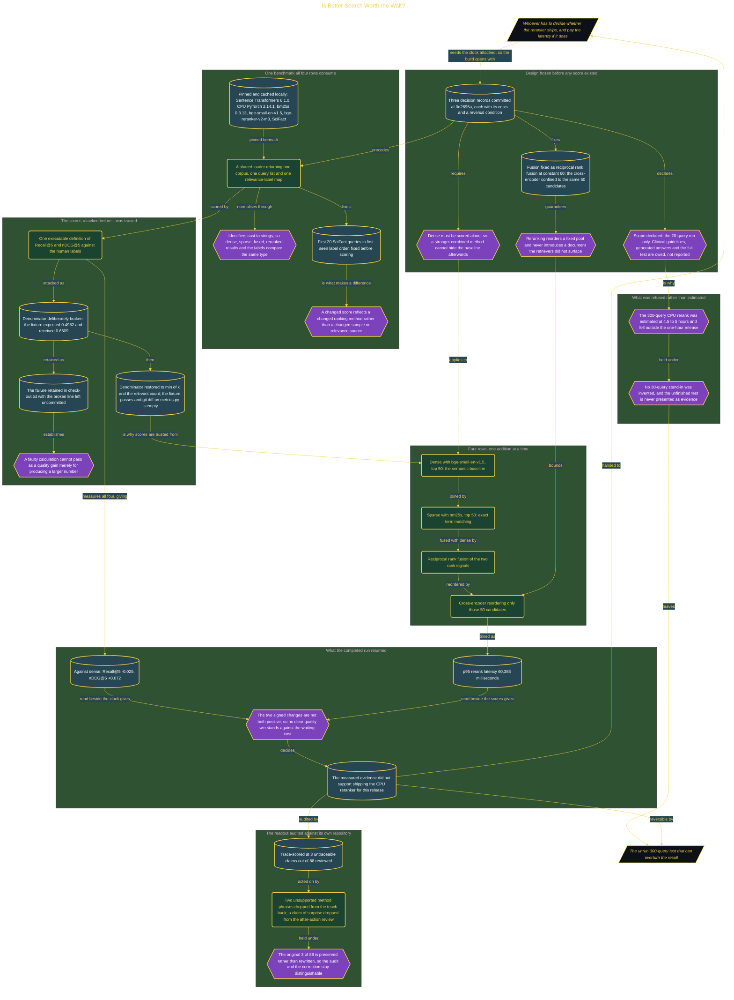

# Is Better Search Worth the Wait?

> Inside the [Build & Brew: The AI Dojo](../../README.md) cohort · *A live build toward the high-performing solutions engineer.*

## Overview

A cross-encoder reranker is the standard answer when retrieval quality is not good enough, and it gets quoted in quality points with no clock attached. This build attaches the clock. Four rows run against the same 20 SciFact queries, corpus, identifiers and scoring functions: dense alone, sparse alone, hybrid, and hybrid plus rerank, each measured on Recall@5, nDCG@5 and p95 latency so a quality change can be read beside the CPU time it cost.

The comparison was frozen before any score existed. Three decision records committed at `0d2695a` fix what the later numbers have to fill, and each carries its own reversal condition. Dense must be scored alone, so a stronger combined method cannot hide the baseline after the fact. Fusion is reciprocal rank fusion at constant 60, and the cross-encoder is confined to the same 50 candidates that fusion produced, so reranking reorders a fixed pool and never introduces a document the retrievers failed to surface. A shared loader returns one corpus, one query list and one label map that all four rows consume, with identifiers cast to strings, so a changed score is attributable to the ranking method rather than to a changed sample.

The scorer was attacked before any retrieval number was trusted. Breaking the nDCG denominator made the fixture return 0.6509 against an expected 0.4982, and that failure was kept in `check-out.txt` with the broken line left uncommitted, so a faulty calculation could not pass as a quality gain merely for producing a larger number. Restoring `min(k, len(relevant))` returned the fixture to 0.4982, and an empty `git diff` on `metrics.py` proves the working scorer matches the committed passing version.

Then the reranker split the difference and lost. Against dense it moved Recall@5 by **-0.025** and nDCG@5 by **+0.072**, so the signed changes were not both positive, at a p95 of **60,388 milliseconds**. A minute of waiting for a mixed result did not support shipping it for this release. The readout was trace-scored at **3 untraceable claims out of 88**, and the three were removed rather than explained: the teach-back lost two unsupported method phrases and the after-action review dropped a claim of surprise that no retained evidence recorded, with the original score preserved rather than rewritten. The 300-query test that could overturn the result was left unrun at an estimated 4.5 to 5 hours, with no smaller stand-in invented to fill the gap.

## Architecture

The diagram shows the topology and data flow of the system as built. The full architectural narrative, with screenshots and prose, lives in [`documents/retrieval-rerank-benchmark.md`](./documents/retrieval-rerank-benchmark.md).

## Implementation

This system is built across **7 phases**:

1. Defining an Evidence-Backed Retrieval Review
2. Preparing a Local Benchmark for Timed Evaluation
3. Freezing the Design Decisions Before Building
4. Establishing Trustworthy Metrics and Human Labels
5. Building and Stress-Testing Four Search Stages
6. Measuring the Reranker and Publishing the Review
7. Testing Whether Reranker Lift Holds at Full Scale

For the full walkthrough with screenshots and step-by-step content, see [`documents/retrieval-rerank-benchmark.md`](./documents/retrieval-rerank-benchmark.md).

## Validation

Each build phase below is documented in [`documents/retrieval-rerank-benchmark.md`](./documents/retrieval-rerank-benchmark.md), with screenshots, configuration, and notes as captured during the build:

- ✅ Defining an Evidence-Backed Retrieval Review
- ✅ Preparing a Local Benchmark for Timed Evaluation
- ✅ Freezing the Design Decisions Before Building
- ✅ Establishing Trustworthy Metrics and Human Labels
- ✅ Building and Stress-Testing Four Search Stages
- ✅ Measuring the Reranker and Publishing the Review
- ✅ Testing Whether Reranker Lift Holds at Full Scale
